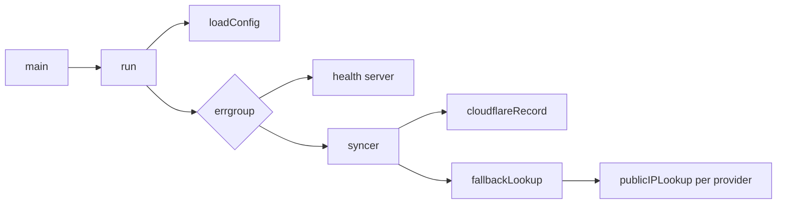

# Architecture

The daemon is a single Go package (`package main`) with no framework. Each file has one job.

| File | Responsibility |
|---|---|
| `main.go` | Turns SIGINT and SIGTERM into a cancelled context and calls `run` |
| `app.go` | Runs either the daemon or the `healthcheck` subcommand, and wires the parts together |
| `config.go` | Reads and validates the environment variables |
| `syncer.go` | The sync loop: load the record, then compare and update it every interval |
| `publicip.go` | Finds the public IPv4 address: the provider list, response parsers and the fallback with cooldowns |
| `cloudflare.go` | Reads and updates the DNS record through the Cloudflare API |
| `fetch.go` | Shared HTTP request helper and error classification |
| `health.go` | The `/healthz` endpoint and the probe the `healthcheck` subcommand runs |

## Startup

`run` loads the configuration, then starts two goroutines under one `errgroup`: the health server and the syncer. If either stops with an error, the other is cancelled and the process exits.

## A sync

1. At startup the syncer reads the record's current address with `cloudflareRecord.Content`. That call also checks the record is an `A` record with the configured name. Temporary errors are retried every 30 seconds.
2. Every interval it asks `fallbackLookup.Current` for the public IP.
3. If the address differs from the last known one, it calls `cloudflareRecord.Update`, which sends a `PUT` with the new address, the name, the TTL and `proxied: false`.
4. Each successful sync marks the health state, which keeps `/healthz` at `200`.

A permanent error, such as a rejected token, records a permanent failure in the health state and ends the syncer after an hour (see [failure handling](failure-handling.md)).

## Finding the public IP

`publicip.go` has three layers:

- **The provider registry** (`ipProviders`) is an ordered list. Each entry has a URL, an optional DNS fallback URL, a function that extracts the address from the response (plain text, Cloudflare's `key=value` trace, JSON or a DNS-over-HTTPS answer) and an optional `Accept` header. Its order is the default `IP_PROVIDERS` order.
- **`publicIPLookup`** asks one provider. It fetches the URL, extracts the address, and accepts it only if it parses as IPv4.
- **`fallbackLookup`** tries the providers in order and remembers failures per provider. It applies the cooldowns, the early stop during outages and `Retry-After`.

All lookups share one HTTP client that only dials over IPv4, so a dual-stack host never reports an IPv6 address.

## Errors

`fetch` sorts failures into three kinds, which the rest of the code acts on:

- **`transportError`**: no usable response arrived (DNS, connection, TLS, timeout, or a body cut short). Used to tell a local outage from a provider that answered with an error.
- **`statusError`**: a non-`200` response, carrying the status and any `Retry-After`.
- **Permanent errors** (`permanent`): `401`, `403`, `404` and an invalid record. The syncer stops on these instead of retrying.

## Testing

Tests sit beside each file. They run against `httptest` servers instead of the real providers or Cloudflare, and the fallback tests use an injected clock, so the suite runs in about a second. Run it with `go test -race ./...`.
