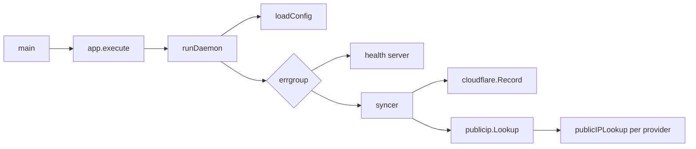

# Architecture

The module `github.com/TheRyanHowell/cloudflare-ddns-go` follows Go's [module layout](https://go.dev/doc/modules/layout): the command lives in `cmd/`, packages only the command needs live in `internal/`, and there is no framework.

| Package | Responsibility |
|---|---|
| `cmd/cloudflare-ddns` | The binary. `main.go` turns SIGINT and SIGTERM into a cancelled context and calls `app.execute`. `cli.go` builds the [cobra](https://github.com/spf13/cobra) command tree and maps errors to exit codes, `flags.go` declares the flags and overlays them on the environment, `app.go` runs the daemon and the `healthcheck` probe, `sync.go`, `ip.go` and `version.go` hold the other commands, and `config.go` reads and validates the settings |
| `ddns` | The sync loop. `Syncer.Run` loads the record, then compares and updates it every interval; `Syncer.Sync` is a single read, compare and update |
| `publicip` | Finds the public IPv4 address: the provider registry, response parsers and the fallback with cooldowns (`New`, `Lookup.Current`) |
| `cloudflare` | Reads and updates the DNS record through the Cloudflare API (`NewRecord`, `Record.Content`, `Record.Update`) and decides which of its errors are permanent (`IsPermanent`) |
| `internal/fetch` | Shared HTTP request helper and error classification |
| `internal/health` | The `/healthz` endpoint and the probe the `healthcheck` command runs |

`ddns` depends only on small interfaces it declares itself: `RecordStore` (`Content`, `Update`), `IPSource` (`Current`) and an optional `HealthReporter`. The command passes it a `cloudflare.Record`, a `publicip.Lookup`, the `health.State` and `cloudflare.IsPermanent` as the permanent-error check, so `ddns` imports neither `cloudflare` nor the health code.

## Commands

The root command and `run` both run the daemon, so a bare `cloudflare-ddns` behaves as it always has. The other commands share the same configuration code.

| Command | Flags | Does |
|---|---|---|
| `run` (and the root) | all | Loads the configuration and runs the health server and the syncer until stopped |
| `sync` | token, token-file, zone-id, record-id, record-name, ttl, providers | One `Syncer.Sync`, then prints what changed. It never starts the health server |
| `ip` | providers | One `Lookup.Current`, then prints the address |
| `healthcheck` | health-addr | Probes `/healthz` of a running daemon |
| `version` | none | Prints the version set with `-ldflags -X main.version`, else the module version from the build information, else `dev` |

Flags are an overlay on the environment, not a second configuration path. `overlay` returns a `getenv` that answers from the flags that were set and falls back to the real environment, and the existing loaders (`loadConfig`, `ipProviderList`, `healthAddr`) read from it. Every validation rule and error message therefore applies to flags as well. Setting either token flag hides all the token variables, so a flag cleanly replaces the environment's token.

`app.execute` returns the exit code. Cobra's usage and error printing are silenced, and the errors are mapped by hand: a `usageError` (unknown command, bad flag or stray argument) prints the command's usage and exits `2`, and any other error is logged and exits `1`, except a cancellation caused by SIGINT or SIGTERM, which exits `0` like the daemon. `sync` learns the record's previous address by wrapping the `RecordStore` in `observedRecord`, because `Syncer.Sync` reports only the new address and whether it changed.

## Startup

In `cmd/cloudflare-ddns`, `runDaemon` loads the configuration, then starts two goroutines under one `errgroup`: the health server and the syncer. If either stops with an error, the other is cancelled and the process exits.

## A sync

1. At startup the syncer reads the record's current address with `cloudflare.Record.Content`. That call also checks the record is an `A` record with the configured name. Temporary errors are retried every 30 seconds.
2. Every interval it asks `publicip.Lookup.Current` for the public IP.
3. If the address differs from the last known one, it calls `cloudflare.Record.Update`, which sends a `PUT` with the new address, the name, the TTL and `proxied: false`.
4. Each successful sync marks the health state, which keeps `/healthz` at `200`.

A permanent error, such as a rejected token, records a permanent failure in the health state and ends the syncer after an hour (see [failure handling](failure-handling.md)).

## Finding the public IP

`publicip` has three layers:

- **The provider registry** (`ipProviders`) is an ordered list, built afresh on each call so no state is shared. Each entry has a URL, an optional DNS fallback URL, a function that extracts the address from the response (plain text, Cloudflare's `key=value` trace, JSON or a DNS-over-HTTPS answer) and an optional `Accept` header. Its order is the default `IP_PROVIDERS` order, which `publicip.Providers` returns; `publicip.New` rejects unknown or repeated names.
- **`publicIPLookup`** asks one provider. It fetches the URL, extracts the address, and accepts it only if it parses as IPv4.
- **`Lookup`** tries the providers in order and remembers failures per provider. It applies the cooldowns, the early stop during outages and `Retry-After`.

All lookups share one HTTP client that only dials over IPv4, so a dual-stack host never reports an IPv6 address.

## Errors

`fetch.Body` sorts failures into kinds, which the rest of the code acts on:

- **`fetch.TransportError`**: no usable response arrived (DNS, connection, TLS, timeout, or a body cut short). `publicip` uses it to tell a local outage from a provider that answered with an error.
- **`fetch.StatusError`**: a non-`200` response, carrying the status code and any `Retry-After` (read with `fetch.RetryAfter`).
- **Permanent errors** (`cloudflare.IsPermanent`): `401`, `403`, `404` and `cloudflare.ErrInvalidRecord`. The syncer stops on these instead of retrying.

## Testing

Tests sit beside the code in each package, and fuzz tests cover the parsers and validators. They run against `httptest` servers instead of the real providers or Cloudflare, and the fallback tests use an injected clock, so the suite runs in about a second. The command tests run the cobra tree through `app.execute` with captured streams and an HTTP client that redirects every request to one `httptest` server, so `sync` and `ip` are tested end to end without the network. Run it with `go test -race ./...`.

## Building and releasing

- **Platforms** are listed once, in `PLATFORMS` in the `Makefile`. `make` maps the host's `uname -m` to a Docker platform for `make run` and `make image`, and `make images` builds every platform.
- **The Dockerfile** cross-compiles: the build stage runs on the build machine and sets `GOOS`, `GOARCH` and `GOARM` from the target platform, so no emulation is needed. The final image is `scratch` with the CA bundle and the binary, running as UID 65532.
- **CI** (`.github/workflows/ci.yml`) runs the tests with the race detector, golangci-lint, govulncheck, `make check-platforms` and `make images` on every push to `master` and on pull requests.
- **Releases** (`.github/workflows/release.yml`) run GoReleaser when a `v*` tag is pushed. `.goreleaser.yaml` builds the command for every Linux platform in `PLATFORMS` plus macOS, Windows and FreeBSD, stamps the version with `-ldflags -X main.version`, and attaches archives and checksums to the GitHub release. `make check-platforms` keeps its Linux targets in step with `PLATFORMS`.

See also [configuration](configuration.md) for settings and [library](library.md) for using the packages.
